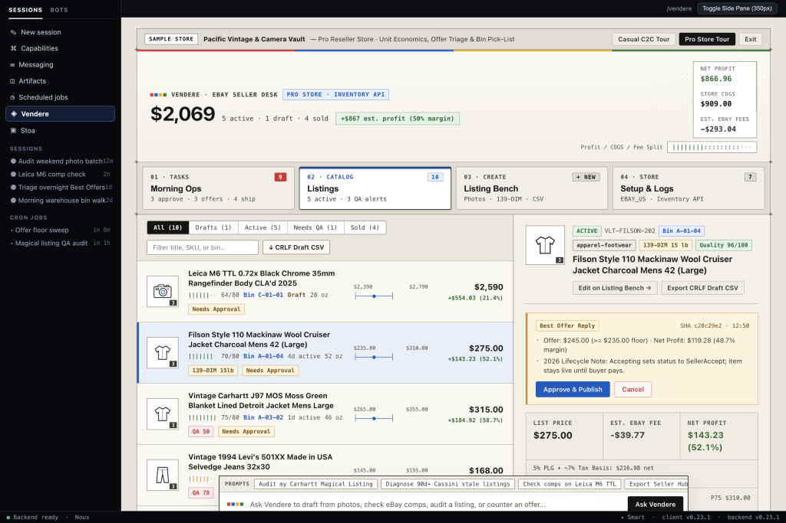
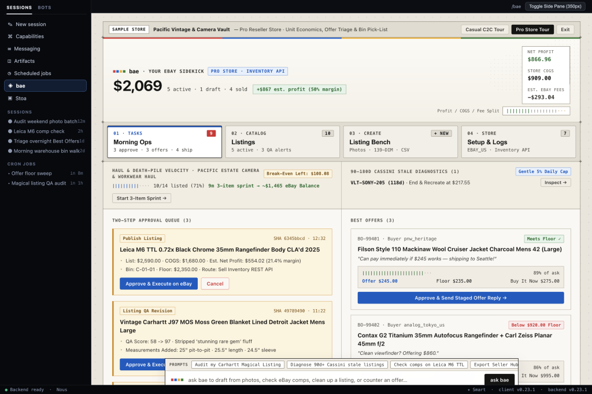
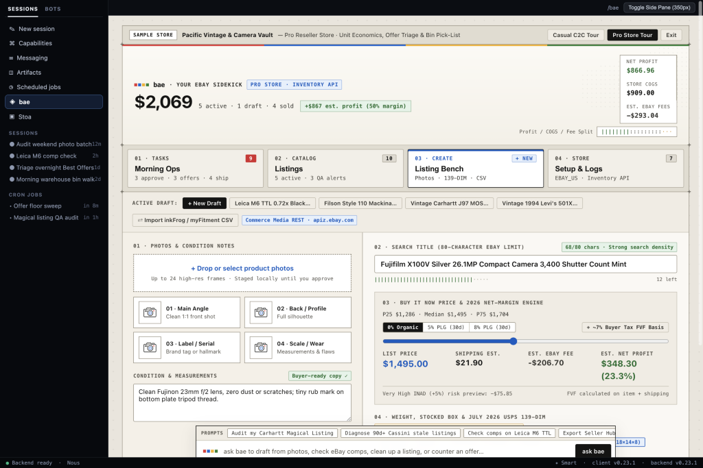
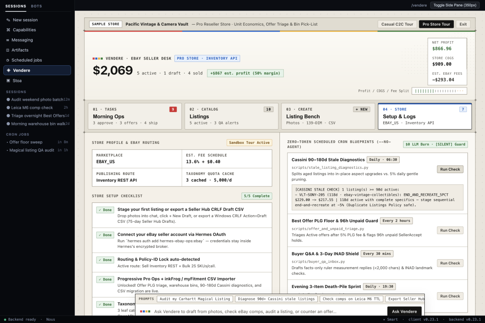
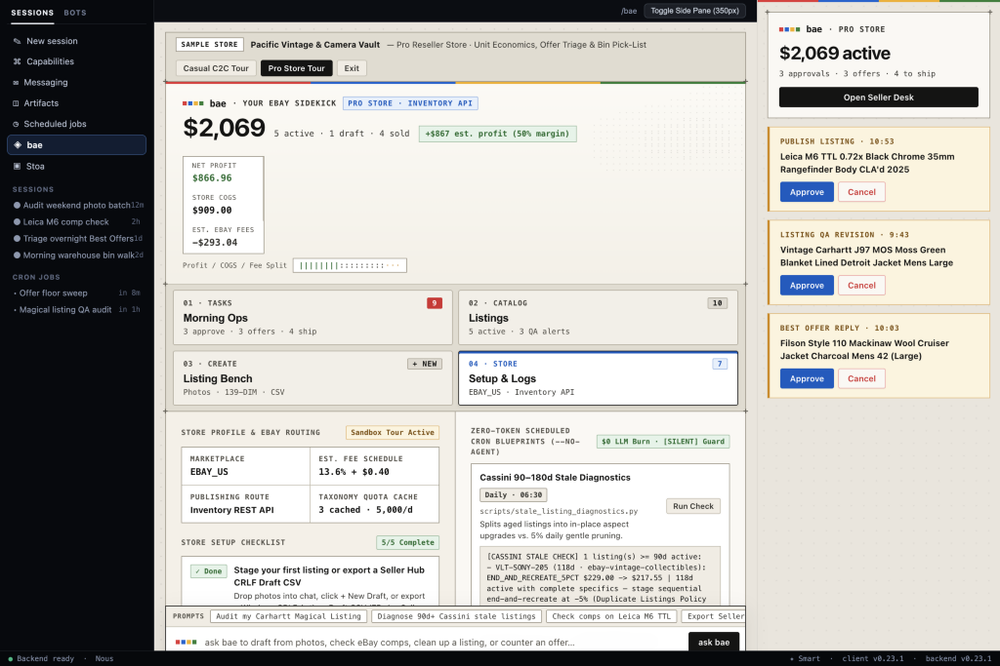

# bae

**your eBay sidekick for [Hermes Agent](https://github.com/NousResearch/hermes-agent)** (`hermes-ebay-ops`)

`bae` helps you turn item photos and quick notes into accurate eBay listings, check real comparable prices, see your true take-home profit after fees and shipping, and stay on top of offers and packing — with both a full-screen **Seller Desk** (`/bae`) and a compact **Side Pane** right inside Hermes.

**Nothing ever goes live on eBay behind your back.** Every new listing, edit, Best Offer reply, or bulk CSV import is staged locally first and waits for your approval before touching your live store.



---

## What bae Does

- **Draft from Photos & Clean Up Generic AI Copy** — Drop photos and quick measurement or flaw notes into chat so `bae` can build search-friendly 80-character titles, item specifics, and factual condition notes. You can also audit existing eBay "Magical Listings" to strip out vague AI filler (like *"stunning rare gem"*) that leads to buyer returns.
- **True Net Profit & Shipping Box Math** — Previews your real payout after Final Value Fees (including estimated buyer sales tax), Promoted Listings General (`PLG`) ad rates (`0% / 5% / 8%`), and return-rate surcharges. Includes **July 2026 USPS dimensional weight** (`L × W × H / 139` for boxes over 1 cubic foot) so bulky jackets, shoes, or kitchenware don't lose money at the post office.
- **Built-In Category Rules** — Checks eBay's latest category rules before you publish:
  - **Apparel & Footwear**: Standardized size values, pre-owned fashion condition grades, flat-lay ruler measurements, and Ship With eBay protection reminders on \$200–\$500 items.
  - **eBay Motors Parts**: Front-loaded OEM part numbers (`MPN`), Year/Make/Model compatibility tables (replacing `myFitment`), and 30-day free return checks on new parts over \$10.
  - **Vintage & Collectibles**: Keeps mold or box numbers (such as Pyrex `#443`) in `Pattern` instead of `MPN` so eBay's catalog doesn't overwrite vintage listings with wrong stock descriptions.
  - **Cards, Coins & Media**: Grading/certification specifics and eBay Standard Envelope weight and value checks.
- **Publish Directly or Export Seller Hub Draft CSVs** — Push approved listings directly through eBay's API, or export clean Windows `CRLF` CSVs that upload straight into **Seller Hub Drafts** (saved for 75 days) if you prefer adding mobile photos on your phone. Also imports legacy **`inkFrog`** and **`myFitment`** CSVs for bulk publishing (`<=25` SKUs per API batch).
- **Scales from Closet Cleanouts to Full-Time Stores** — Casual sellers never have to deal with SKUs, cost of goods, or storage bins. As soon as you record a cost basis, minimum offer floor, or bin location on any item, `bae` automatically turns on reseller workflows: Best Offer floor comparisons, bin-sorted packing lists, 90+ day stale-listing checks, and haul break-even tracking.
- **Zero-Cost Scheduled Checks** — Optional background scripts check for stale listings, pending Best Offers, buyer questions, or unlisted haul inventory on a schedule without calling an LLM (`\$0` token cost), staying completely quiet whenever nothing needs your attention.

---

## Inside the Seller Desk

### 01 · Morning Ops
Review staged changes waiting for your approval, compare incoming Best Offers against your minimum floor price, check 90+ day stale listings, track haul break-even progress, and print bin-sorted packing slips.



### 03 · Listing Bench
Add photos and measurements, tune your 80-character title, test pricing against active eBay comps and ad rates, check box dimensions against USPS dimensional-weight thresholds, or import `inkFrog` / `myFitment` CSVs.



### 04 · Setup & Logs
Check your eBay account connection and cached category quotas, run zero-cost scheduled checks on demand, view bundled category playbooks, and inspect the full activity log.



### Compact Side Pane
Keep a 350px summary open right next to Hermes chat to check active store totals, approve or cancel staged changes, or switch sample store tours without leaving your conversation.



---

## Quick Start

### 1. Install in Hermes

Once listed in the Hermes Plugin Catalog:

```bash
hermes plugins install bae
```

Or install directly from GitHub / validate locally:

```bash
git clone https://github.com/jarrett-del/bae.git
hermes plugins validate ./bae
```

Copy or symlink the folder into `~/.hermes/plugins/hermes-ebay-ops` if installing manually.

### 2. Connect Your eBay Account (or Try the Built-In Sample Tours)

`bae` never reads `.env` files or raw tokens in Python. Set `EBAY_PLUGIN_CLIENT_ID` and `EBAY_PLUGIN_CLIENT_SECRET` in your shell environment, then sign in through Hermes's encrypted OAuth broker:

```bash
hermes auth add hermes-ebay-ops:ebay
```

> **Want to take it for a spin before connecting eBay?** Open **bae** (`/bae`) in Hermes and click **Casual C2C Tour** or **Pro Store Tour** at the top of the screen. Sample tours run in a separate `tour.db` file so your real store database stays untouched.

### 3. Run Tests Locally

```bash
python3 -m venv .venv
.venv/bin/pip install -e ".[dev]" fastapi httpx

node --input-type=module --check < desktop/plugin.js
node --input-type=module --check < dashboard/dist/index.js
.venv/bin/pytest -q
```

---

## Agent Tools (`toolset="ebay_ops"`)

| Tool | Availability | Write Behavior | What It Does |
| :--- | :--- | :--- | :--- |
| `ebay_stage_listing` | Always on | Stages approval | Prepares a draft listing from photos and notes, checks category rules and shipping/fee math, and creates an approval token. |
| `ebay_audit_active_listing` | Always on | Stages approval | Reviews a live eBay listing for generic AI filler, missing item specifics, or price drift, and stages a clean revision. |
| `ebay_check_comps` | Always on | Read-only | Looks up comparable active eBay listings (by keyword or image) alongside your own past sold prices. |
| `ebay_confirm_action` | Always on | **Executes write** | Runs a staged publish, revision, policy setup, offer reply, or bulk publish after verifying your approval token. |
| `ebay_export_draft_csv` | Always on | Local CSV file | Exports staged drafts as a Windows `CRLF` CSV formatted for eBay Seller Hub Drafts. |
| `ebay_triage_offers` | Pro mode | Stages approval | Compares active Best Offers against your floor price and ad fees, flags 96-hour unpaid accepted offers, or stages a reply. |
| `ebay_lookup_bin` | Pro mode | Read-only | Builds a bin-sorted (`A-1` -> `A-2` -> `A-10`) warehouse pick-list for paid orders awaiting shipment. |
| `ebay_import_migration_csv` | Pro mode | Stages approval | Imports `inkFrog`, `myFitment` (Year/Make/Model), or Seller Hub CSVs and stages a bulk publish (`<=25` SKUs per API call). |
| `ebay_diagnose_stale` | Pro mode | Read-only | Checks active listings older than 90 days and recommends either adding missing item specifics in place or gentle daily relisting. |

---

## Project Layout

```text
bae/
├── LICENSE                          # MIT License
├── README.md
├── SPEC.md                          # Core architectural specification
├── plugin.yaml                      # Hermes v2 plugin manifest (OAuth, settings, 9 tools)
├── pyproject.toml
├── __init__.py                      # Plugin registration & progressive Pro mode check
├── config.py                        # Mode flags, fee defaults, approval token TTL
├── models.py                        # Pydantic v2 data models
├── db.py                            # 4-table SQLite store (seller_profile, items, pending_actions, item_events)
├── cache_store.py                   # 7-day category aspect cache & haul break-even tracking
├── compliance.py                    # Category sizing, condition, MPN, duplicate-title & VeRO checks
├── csv_drafts.py                    # Seller Hub Draft CSV exporter & inkFrog/myFitment importer
├── diagnostics.py                   # 90+ day stale-listing checks, 96h unpaid offer guard, Q&A drafter
├── demo.py                          # Built-in Casual C2C & Pro Store sample tours
├── adapter/                         # Live eBay REST/XML client & offline mock fixtures
├── tools/                           # Tool handlers, fee math, and USPS 139-DIM shipping helpers
├── scripts/                         # Zero-token (--no-agent) scheduled background scripts
├── skills/                          # 5 bundled SKILL.md guides (general ops + 4 category playbooks)
├── dashboard/                       # FastAPI backend routes + 350px Side Pane bundle
├── desktop/                         # Full-screen 4-tab Seller Desk UI (/bae)
├── docs/                            # Reference documentation & screenshots
└── tests/                           # 29-test automated verification suite
```

---

## Disclosure

- **Network calls**: `bae` makes zero outbound network calls in sample-tour (`mock`) or offline CSV mode. When you connect an eBay account (`hermes auth add hermes-ebay-ops:ebay`), live API requests go exclusively through Hermes's OAuth broker (`credentialed_provider_request`) to `api.ebay.com`, `apiz.ebay.com`, and `apim.ebay.com`. Plugin code never reads `.env` files or raw OAuth tokens.
- **Filesystem access**: Reads local item photo paths passed to `ebay_stage_listing` and migration CSV files passed to `ebay_import_migration_csv`. Writes only inside Hermes's profile-scoped `plugin_data_dir` (SQLite databases `state.db`, `tour.db`, and exported Seller Hub draft CSV files).
- **Execution & sessions**: Runs zero shell commands, subprocesses, or background daemons. Optional scripts in `scripts/` run only when explicitly triggered by you or a Hermes `--no-agent` schedule. Submitting a prompt in the Seller Desk `ask bae` dock sends your message to a visible Hermes conversation, and every live eBay write (`publish`, `revise`, `offer_reply`, `bulk_publish`, `bootstrap_policies`) requires an explicit approval token.

---

## Further Reading

- [**Architecture, Security & API Routing**](docs/architecture-and-security.md) — How OAuth isolation, two-step approval tokens, SQLite storage, and eBay REST/XML routing work under the hood.
- [**2026 Fee Math, Shipping & Category Rules**](docs/2026-ebay-playbook-and-economics.md) — Details on USPS `139` dimensional weight, Promoted Listings attribution, and category-specific checks.
- [**CSV Migration, Seller Hub Drafts & Scheduled Checks**](docs/migration-cron-and-setup.md) — Importing `inkFrog` / `myFitment` files, exporting Seller Hub Drafts, running `--no-agent` scheduled scripts, and eBay developer quota tips.
- [**Original Specification (`SPEC.md`)**](SPEC.md)

## License

MIT
